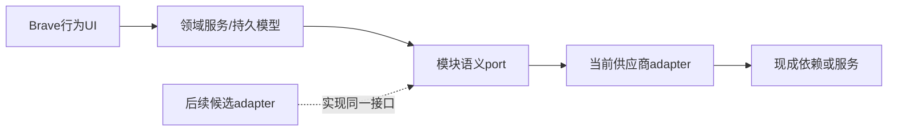

# 行为契约与依赖映射

业务服务、持久化和UI依赖稳定的Brave行为语义；第三方实现封装在所属模块adapter。替换一个依赖应主要修改adapter和静态装配，不传播供应商类型。

| 模块 | 稳定语义 | 依赖映射 | 替换时保留 |
| --- | --- | --- | --- |
| BrowserCore/Storage | 标签、导航、资料、事务 | Electron与SQLite平台port | wire和业务schema |
| Shields | 请求判定、CSP、页面过滤、规则生命周期 | FilterEnginePort→Ghostery adapter | 规则源/站点策略/旧规则版本 |
| 扩展 | 安装、权限、API、action、生命周期 | LibraryAdapterPort→固定扩展库 | 资料清单/批准权限/版本 |
| 页面工具 | 阅读、翻译、截图与取消 | 各provider port→Readability/Brave翻译/Electron | 页面授权、navigation身份 |
| Leo | 会话、模型能力、增量响应与取消 | Provider→自定义/官方adapter | 归一化消息与密钥引用 |
| 系统组件 | 启停、连接状态、版本与回滚 | Component/Helper port→指定组件 | 业务状态与用户配置 |

接口包括能力描述、支持范围、错误分类、AbortSignal或取消句柄、释放和版本。规则缓存等供应商产物必须标记providerId/版本/schema；不兼容缓存重建，不能混读旧缓存。替换不改变用户数据含义，失败恢复上一可用版本；能力差异单独记录。

仅为实际模块定义所需接口，当前只实现已批准依赖。候选接入不需要新增后端、内核或通用插件平台。映射层的存在不证明两个实现已经行为等效，仍按模块行为证据记录。
