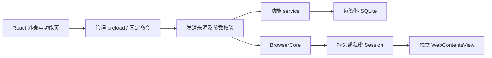

# 模块边界

主进程 BrowserCore 独占窗口、标签、导航、资料和布局。功能 service 独占业务数据，通过 StorageHost 按资料事务提交；管理 UI 使用受限 browser-client，不直接访问数据库或 Electron。

- shared/contracts：wire schema 和事件；runtime-ports：主进程内共享接口。
- main/bootstrap：静态 feature/迁移装配和逆序释放。
- main/browser-core、main/platform：Electron 生命周期与平台接入。
- renderer/shell：状态镜像与浏览器外壳；内页由 routes 静态导入。
- features：完整模块 main/page/renderer，业务逻辑不集中到入口。

私密 Session 不持久，历史和恢复禁止写普通数据库。显式收藏操作沿 Chromium 原始资料书签模型。远程网页和扩展内容不得加载管理 preload。
